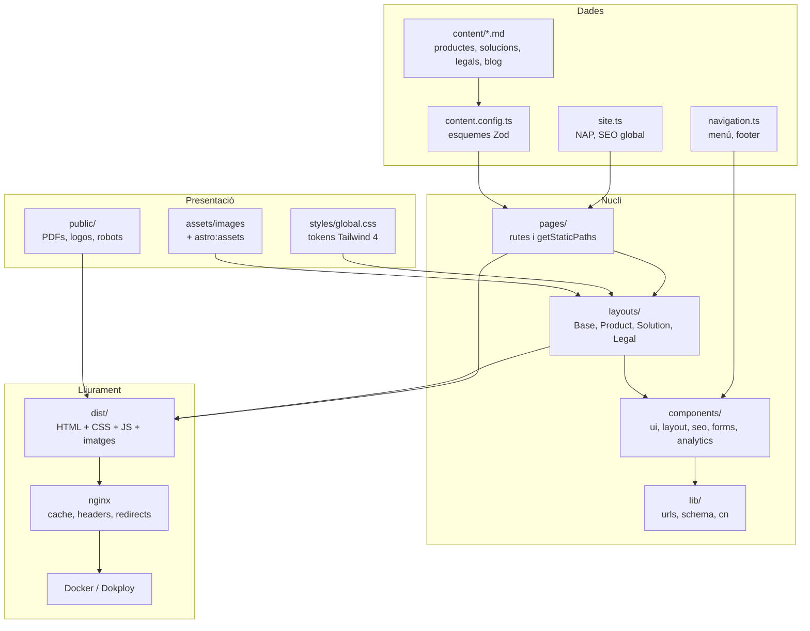
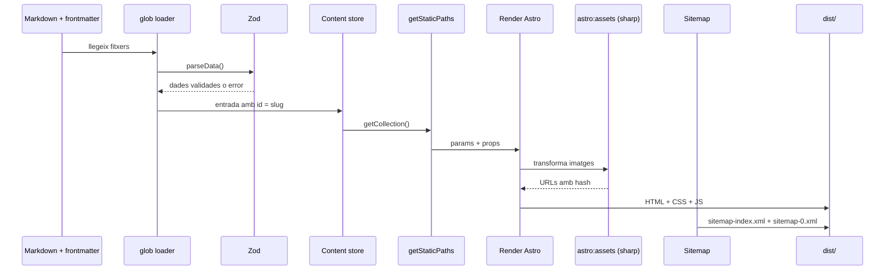
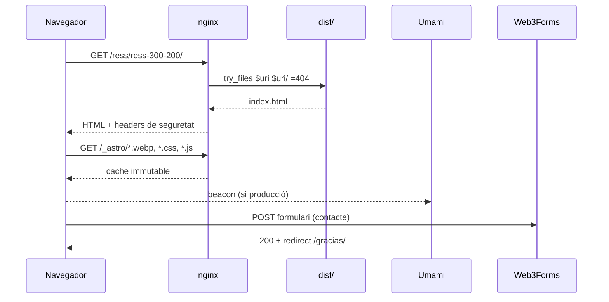

# 01 — Arquitectura i fonaments

## 1. Resum executiu

`web-lifetech` és un **lloc estàtic multipàgina** generat amb Astro 7. No té base de dades, ni servidor d'aplicació, ni autenticació, ni estat en runtime. El build converteix contingut Markdown + esquemes Zod + plantilles Astro en un directori `dist/` que nginx serveix tal qual.

L'arquitectura està optimitzada per a un web **corporatiu i de catàleg** amb aquestes característiques:

- Poques desenes de pàgines, amb creixement previst però no massiu.
- Contingut textual i tècnic que ha de posicionar-se (SEO).
- Formulari de contacte delegat a un tercer (Web3Forms).
- Analítica sense cookies (Umami).
- Equip petit, sense necessitat d'un CMS pesat ni d'un backend propi.
- Preservació d'URLs i SEO d'una migració des de WordPress + Divi.

La conclusió de l'auditoria és que **Astro és una bona elecció per al problema actual**. El coll d'ampolla no és el framework, sinó **el model de dades i la navegació**, que encara tenen acoblaments manuals (vegeu [08](08-escalabilitat-i-evolucio-del-model.md) i [09](09-deute-tecnic-i-riscos.md)).

## 2. Context de la migració

El projecte neix de `https://life-tech.es/`, un WordPress amb Divi. Al repositori hi ha evidències del procés:

- `lifetech.WordPress.2026-11-08.xml`: exportació de WordPress (contingut, URLs, mitjans).
- `scripts/import-media.mjs`: descàrrega i normalització d'imatges des de `wp-content/uploads`.
- `deploy/nginx/redirects.conf`: redirects 301/410 per a URLs llegades.
- `README.md`: fases de migració i estat.
- `src/content/**`: contingut migrat a Markdown.

La migració no és només visual. Les decisions que més impacte tenen són:

| Decisió | Motiu | Efecte |
|---|---|---|
| Mantenir barra final | El WordPress original serveix `/ruta/` | Evita canònics duplicats i redirects massius |
| Mantenir slugs castellans | URLs indexades | Preserva autoritat SEO |
| Redirects 301 per a URLs catalanes i antigues | Canvis de slug/idioma | No perdre tràfic |
| 410 per a superfície WordPress | `wp-admin`, `wp-json`, feeds | Redueix superfície d'atac i soroll |
| Contingut en castellà, codi en català | Convenció de l'equip | Coherència interna |

## 3. Per què Astro

### 3.1 Criteris de decisió

| Criteri | Pes | Per què |
|---|---|---|
| SEO tècnic | Alt | És un web de captació B2B |
| Rendiment | Alt | Mòbil, connexions variables, Core Web Vitals |
| Cost i manteniment | Alt | Equip petit, sense servidor dedicat |
| Facilitat d'edició | Mitjà | Contingut tècnic, canvis no diaris |
| Interactivitat | Baix | Només menú i formulari |
| Escalabilitat de catàleg | Mitjà | Creixement previst de productes/projectes |
| Time-to-market | Alt | Migració amb terminis |

### 3.2 Comparativa

| Opció | Avantatges | Inconvenients per a aquest projecte | Veredicte |
|---|---|---|---|
| **WordPress + Divi** (origen) | CMS conegut, edició visual, plugins | Pes, manteniment, seguretat, Core Web Vitals, dependència de plugins | Descartat |
| **Astro estàtic** | HTML per ruta, zero JS per defecte, Content Collections, imatges optimitzades, deploy trivial | Sense CMS visual, build per publicar | **Triat** |
| **Next.js (App Router)** | Ecosistema, SSR/ISR, React | Més complexitat, més JS, overkill sense backend ni personalització | Descartat |
| **Nuxt** | Bo per Vue, SSR | Mateix overkill; equip sense Vue | Descartat |
| **Eleventy / Hugo** | Molt ràpid, simple | Menys tipatge, menys ecosistema d'imatges i illes | Alternativa viable |
| **HTML a mà** | Zero dependències | Duplicació, sense validació ni escalabilitat | Descartat |

### 3.3 Per què no SSR

No hi ha cap necessitat de render per request:

- El contingut canvia quan algú fa un commit, no quan un usuari navega.
- No hi ha àrea privada, carret, stock ni preus dinàmics.
- No hi ha personalització per usuari.
- El formulari i l'analítica són third-party.

SSR afegiria un runtime, un adaptador, gestió d'errors, escalat i cost, sense cap benefici funcional. Si algun dia cal preus/stock en temps real, es pot fer **híbrid**: mantenir la majoria de rutes estàtiques i renderitzar només les que ho necessitin.

## 4. Principis d'arquitectura

### 4.1 Static-first

Cada URL és un fitxer HTML independent. No hi ha SPA que hidrati tota la pàgina. Això dona:

- TTFB baix (nginx + fitxer).
- Cacheabilitat agressiva.
- Zero errors de runtime al servidor.
- Funcionament sense JavaScript.

### 4.2 Content as data

El contingut repetible viu a col·leccions amb esquema Zod, no dins de les plantilles. Els layouts no consulten col·leccions: reben dades resoltes. Això permet validar, tipar i testar el contingut abans de publicar.

### 4.3 Build-time validation

Els errors moren al build:

- Camp obligatori absent → error.
- Descripció > 160 caràcters → error.
- Imatge inexistent → error.
- `slug` duplicat → error d'id.
- Enllaç intern trencat → `npm run qa` (post-build).

El que **no** es valida: existència de referències (`parent`, `related`, `products`), canonical correcte, og:image accessible, semàntica del JSON-LD. Són els buits principals.

### 4.4 URL stability

La URL és un contracte públic. Es protegeix amb:

- `trailingSlash: 'always'`.
- `build.format: 'directory'`.
- Slugs idèntics als del WordPress original.
- Redirects 301/410 a nginx.

Qualsevol canvi de slug ha de comportar un redirect i una revisió de referències.

### 4.5 Progressive enhancement

El formulari funciona sense JS (`action` + `method`), i el JS només millora l'experiència. El menú necessita JS per obrir-se, però els enllaços existeixen a l'HTML. L'analítica és opcional i no bloqueja.

### 4.6 Zero JS innecessari

No hi ha React, Vue, Svelte ni hidratació. Els únics scripts són el header, el formulari i Umami. Les icones són SVG inline; les fonts són fitxers estàtics; les imatges es pre-generen.

### 4.7 Single source of truth (parcial)

| Dada | Font única? | Observació |
|---|---|---|
| NAP i SEO global | ✅ `src/data/site.ts` | `site.url` també apareix a `astro.config.mjs` |
| Navegació | ❌ `src/data/navigation.ts` | Duplica slugs de col·leccions |
| Productes | ✅ Col·lecció `products` | La navegació no se'n deriva |
| Solucions/projectes | ✅ Col·lecció `solutions` | La navegació no se'n deriva |
| PDFs | ❌ Frontmatter + pàgina de descàrregues | Duplicació manual |
| Rutes | ✅ `slug` + `getStaticPaths` | — |
| Metadades SEO | Parcial | Overrides per entrada + fallback global |

## 5. Mapa de capes



### Responsabilitats

| Capa | Responsabilitat | No hauria de fer |
|---|---|---|
| `data/` | Constants globals i navegació | Consultar col·leccions |
| `content/` | Contingut i metadades | Lògica de presentació |
| `content.config.ts` | Contracte de dades | Renderitzar |
| `pages/` | Routing, resolució de relacions, composició | Estils complexos |
| `layouts/` | Estructura de pàgina i seccions | Consultar `astro:content` |
| `components/` | Peces reutilitzables | Coneixement de rutes concretes |
| `lib/` | Funcions pures (URLs, JSON-LD, classes) | Estat global |
| `styles/` | Tokens i estils base | Lògica |
| `public/` | Actius servits sense transformació | Contingut dinàmic |
| `deploy/` | Servidor i runbook | Lògica de negoci |

## 6. Flux de build



Punts clau:

1. **El loader assigna `id = data.slug`** si el frontmatter té `slug`.
2. **Zod s'executa abans de renderitzar**. Un error atura el build.
3. **`getStaticPaths` decideix les URLs**. No hi ha fallback runtime.
4. **Les imatges es transformen en build** amb sharp; el navegador no descarrega l'original.
5. **El sitemap es genera després** de conèixer les rutes, amb filtres i prioritats.

## 7. Flux de request



No hi ha cap component que consulti una API en render. L'únic trànsit de dades de negoci és el formulari, que va directe del navegador a Web3Forms.

## 8. El contracte `slug = id = URL`

És la peça central de l'arquitectura i mereix un apartat propi. Resum:

```text
frontmatter.slug  →  entry.id  →  params.slug  →  URL  →  canonical
       ↑                                   ↓
       └──── referències (parent, related, products)
```

Implicacions:

- **Una sola font per a la identitat de l'entrada.** No hi ha `id` separat de `slug`.
- **Les referències usen el slug complet**, no el nom del fitxer.
- **Renombrar és una operació global**: fitxer + slug + referències + redirect.
- **Els ids són únics per col·lecció**, no globalment. Dues col·leccions podrien tenir el mateix id; el routing ha d'evitar la col·lisió.

Aquesta decisió simplifica molt el model actual i és la raó per la qual `getStaticPaths` és tan curt. També és la raó per la qual un error de referència és silenciós: si el `parent` no coincideix, el layout no troba l'entrada i simplement no pinta el vincle.

## 9. Què **no** té l'arquitectura

| Absent | Per què és OK ara | Quan caldria |
|---|---|---|
| Base de dades | No hi ha estat persistent | Preus, stock, usuaris, comandes |
| Autenticació | Web públic | Àrea de client, distribuïdors |
| SSR / adaptador | Tot és estàtic | Contingut per usuari o per request |
| CMS visual | Contingut via Git | Editors no tècnics freqüents |
| Cerca interna | Catàleg petit | >50 productes o molts articles |
| i18n | Només castellà | Expansió a català/anglès |
| Comentaris | No és un blog actiu | Blog amb comunitat |
| Ecommerce | No es ven online | Configurador o botiga |
| Tests unitaris | Build + QA cobreixen el bàsic | Refactors grans o lògica complexa |

## 10. Trade-offs assumits

| Trade-off | Cost | Benefici |
|---|---|---|
| Estàtic vs dinàmic | Publicar requereix build | Simplicitat, seguretat, cost zero de runtime |
| Git vs CMS | Un editor ha de fer PR | Historial, revisió, tipus, validació |
| Frontmatter estructurat vs Markdown lliure | Duplicació d'alguns camps | Seccions riques i validades |
| Navegació manual vs derivada | Oblit fàcil en afegir productes | Control editorial del menú |
| Un sol catch-all per a productes i legals | Risc de col·lisió de slugs | Menys fitxers i rutes simples |
| Tailwind vs CSS a mida | HTML amb moltes classes | Tokens consistents i menys CSS mort |
| nginx propi vs hosting estàtic | Cal mantenir Docker | Redirects, headers i control total |

## 11. Quan revisar aquesta arquitectura

Els senyals que justificarien un canvi:

1. **Més de ~200 productes** o necessitat de filtrar/comparar → cal tipar specs, taxonomies i cerca.
2. **Editors no tècnics** que publiquen setmanalment → CMS Git-based o API.
3. **Més d'un idioma** → routing i18n, contingut per locale, hreflang.
4. **Preus, stock o configurador** → dades dinàmiques; SSR híbrid o API client.
5. **Build > 5–10 min** de forma habitual → paral·lelització, imatges externes, build incremental.
6. **Equip gran** amb necessitat de preview per branca → CI + entorns efímers.

Mentre no es doni cap d'aquests, l'arquitectura actual és adequada. El que cal millorar abans no és el framework, sinó **el model de dades i la seva validació**.

## 12. Evidència vs inferència

| Afirmació | Tipus | Font |
|---|---|---|
| Mode estàtic, sense adaptador | Evidència | `astro.config.mjs` no declara `adapter` |
| `slug` es converteix en `id` | Evidència | `node_modules/astro/dist/content/loaders/glob.js` (`generateIdDefault`) |
| 40 pàgines al build auditat | Evidència | Recompte de `dist/**/*.html` |
| Zero frameworks de UI | Evidència | `package.json` |
| La migració ve de WordPress/Divi | Evidència | README, XML, `import-media.mjs` |
| “L'equip és petit” | Inferència | Abast i convencions del repo |
| “No cal SSR” | Inferència | Absència de funcionalitats dinàmiques |
| “El coll d'ampolla és el model” | Inferència | Patrons de duplicació i acoblament detectats |
