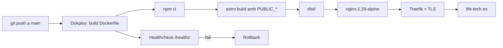

# 02 — Pipeline de build i distribució

Aquest document segueix el viatge complet: des de `npm run build` fins que nginx respon una URL. Inclou les versions reals, la configuració d'Astro, el tractament d'imatges i fonts, l'anatomia de `dist/`, la imatge Docker i les polítiques de caché i seguretat.

## 1. Toolchain

### 1.1 Versions instal·lades

| Paquet | Versió | Rol |
|---|---:|---|
| `astro` | 7.4.7 | Framework i build |
| `@astrojs/mdx` | 8.1.3 | Suport MDX (instal·lat, sense fitxers `.mdx`) |
| `@astrojs/sitemap` | 3.7.4 | Sitemap |
| `@astrojs/rss` | 4.0.19 | RSS (instal·lat, sense ruta) |
| `astro-icon` | 1.2.0 | Icones |
| `@iconify-json/lucide` | 1.2.152 | Set Lucide |
| `sharp` | 0.35.5 | Transformació d'imatges |
| `tailwindcss` | 4.3.5 | CSS utilitari |
| `@tailwindcss/vite` | 4.3.5 | Integració Tailwind 4 amb Vite |
| `@tailwindcss/typography` | 0.5.20 | Classes `prose` |
| `typescript` | 6.0.3 | Tipus |
| `@astrojs/check` | 0.9.12 | `astro check` |
| `prettier` | 3.9.10 | Format |
| `prettier-plugin-astro` | 1.1.2 | Format d'`.astro` |

Requisits: **Node ≥ 22.23.4** (desenvolupat amb Node 24), npm ≥ 9.6.5. El `Dockerfile` fixa `node:24-bookworm-slim`.

### 1.2 Scripts

| Script | Comanda | Què fa |
|---|---|---|
| `dev` | `astro dev` | Servidor local a `:4321` amb HMR |
| `build` | `astro build` | Genera `dist/` |
| `preview` | `astro preview` | Serveix `dist/` localment |
| `check` | `astro check` | TypeScript + diagnòstics d'Astro |
| `qa` | `node scripts/qa.mjs` | QA post-build |
| `og` | `node scripts/generate-og.mjs` | Regenera `public/images/og-default.jpg` |
| `format` | `prettier --write .` | Formata |
| `format:check` | `prettier --check .` | Comprova format |

## 2. Configuració d'Astro

`astro.config.mjs` és curt i deliberat:

```js
import { defineConfig, fontProviders } from 'astro/config';
import mdx from '@astrojs/mdx';
import sitemap from '@astrojs/sitemap';
import icon from 'astro-icon';
import tailwindcss from '@tailwindcss/vite';

const SITE = 'https://life-tech.es';

export default defineConfig({
  site: SITE,
  trailingSlash: 'always',
  build: { format: 'directory' },
  integrations: [
    mdx(),
    icon(),
    sitemap({
      filter: (page) =>
        !page.includes('/gracias/') &&
        !page.includes('/politica-de-cookies-ue/') &&
        !page.includes('/blog/'),
      serialize(item) {
        if (item.url === `${SITE}/`) {
          item.changefreq = 'weekly';
          item.priority = 1.0;
        } else {
          item.changefreq = 'monthly';
          item.priority = 0.7;
        }
        return item;
      },
    }),
  ],
  vite: { plugins: [tailwindcss()] },
  fonts: [ /* Montserrat, Open Sans */ ],
});
```

### 2.1 Decisions

| Línia | Decisió | Motiu |
|---|---|---|
| `site` | `https://life-tech.es` | Canonicals, sitemap i URLs absolutes |
| `trailingSlash: 'always'` | Barra final obligatòria | Preservar URLs del WordPress |
| `build.format: 'directory'` | `ruta/index.html` | Servir carpetes amb nginx |
| `mdx()` | Activat | Permetre `.mdx` en el futur; avui no s'usa |
| `icon()` | Activat | Icones Lucide |
| `sitemap.filter` | Exclou `gracias`, `politica-de-cookies-ue`, `blog` | Pàgines no indexables o inexistents |
| `sitemap.serialize` | Home `weekly/1.0`, resta `monthly/0.7` | Priorització bàsica |
| `vite.plugins` | Tailwind 4 | No hi ha `tailwind.config.js`; tot va a `global.css` |
| `fonts` | Fontsource, latin, variable | Self-hosting i preload |

> [!WARNING]
> `site` està hardcoded a `astro.config.mjs` **i** `site.url` a `src/data/site.ts`. `PUBLIC_SITE_URL` existeix a `.env.example` i `env.d.ts`, però **no s'usa enlloc**. És un risc de deriva: canviar el domini requereix tocar dos fitxers i recordar-lo. Vegeu [09](09-deute-tecnic-i-riscos.md) (R-05).

### 2.2 Sitemap

- Genera `sitemap-index.xml` i `sitemap-0.xml`.
- Exclou `/gracias/`, `/blog/` i la URL llegada `/politica-de-cookies-ue/` (que no es genera).
- Al build auditat conté **37 URLs**. El nou `/productos/` encara no hi és perquè `dist/` és anterior al commit; després del build seran 38.
- `robots.txt` apunta al sitemap.

### 2.3 Fonts

```js
fonts: [
  {
    provider: fontProviders.fontsource(),
    name: 'Montserrat',
    cssVariable: '--font-montserrat',
    weights: ['100 900'],
    styles: ['normal'],
    subsets: ['latin'],
    fallbacks: ['ui-sans-serif', 'system-ui', 'sans-serif'],
  },
  {
    provider: fontProviders.fontsource(),
    name: 'Open Sans',
    cssVariable: '--font-open-sans',
    weights: ['300 800'],
    styles: ['normal'],
    subsets: ['latin'],
    fallbacks: ['ui-sans-serif', 'system-ui', 'sans-serif'],
  },
],
```

`BaseLayout` les carrega amb `<Font cssVariable="..." preload />`. El resultat:

- Dues fonts variables, només subset llatí.
- `@font-face` generat per Astro, fitxers `.woff2` a `dist/_astro/`.
- `preload` de les dues, cosa que afavoreix LCP però afegeix dues peticions crítiques.
- `font-display` el gestiona Astro (normalment `swap`).

Recomanació: si el LCP és text, preload està bé; si és imatge, es podria plantejar preload només de la font del títol.

## 3. Tailwind 4 i tokens

No hi ha `tailwind.config.js`. Tot es declara a `src/styles/global.css`:

```css
@import 'tailwindcss';
@plugin '@tailwindcss/typography';

@theme {
  --font-sans: var(--font-open-sans), ui-sans-serif, system-ui, sans-serif;
  --font-display: var(--font-montserrat), ui-sans-serif, system-ui, sans-serif;

  --color-brand-50: #f2f8fa;
  /* ...fins a brand-900 */
  --color-ink: #1f2933;
  --color-muted: #666666;
  --color-line: #e2e8ed;
  --color-surface: #f3f3f3;
  --color-logo-gray: #a2a2a2;
  --color-danger: #b51e1d;

  --radius-btn: 0.9375rem;
  --shadow-card: 0 8px 30px rgb(0 0 0 / 0.08);
  --shadow-header: 0 2px 20px rgb(0 0 0 / 0.06);
}
```

| Token | Ús |
|---|---|
| `brand-50…900` | Fons, textos, hover, gradients |
| `ink` | Títols i text fort |
| `muted` | Text secundari |
| `line` | Borders |
| `surface` | Fons de secció altern |
| `logo-gray` | Icones i detalls |
| `danger` | Errors i obligatoris |
| `font-display` | Montserrat |
| `font-sans` | Open Sans |
| `radius-btn` | Botons |
| `shadow-card` | Targetes |
| `shadow-header` | Navbar amb scroll |

`@layer base` aplica tipografia, focus visible, selecció, `scroll-margin-top` i `prefers-reduced-motion`. `@layer components` defineix `.container-page` i `.overlay-gradient`.

## 4. Pipeline d'imatges

Totes les imatges de contingut passen per `astro:assets` i sharp. No es serveixen originals.

### 4.1 Matriu d'usos

| Ús | Amplades | `sizes` | Format | Qualitat | Càrrega |
|---|---|---|---|---:|---|
| Hero home | 640, 1024, 1600, 1920 | `100vw` | WebP | 80 | `eager`, `fetchpriority="high"` |
| `PageHero` | 640, 1024, 1600, 1920 | `100vw` | WebP | 80 | `eager`, `fetchpriority="high"` |
| Hero solució | 640, 1024, 1600 | `100vw` | WebP | 80 | `eager`, `fetchpriority="high"` |
| Hero producte | 400, 700, 1000 | 44/80/92vw | WebP | 82 | `eager`, `fetchpriority="high"` |
| Galeria producte | 320, 640, 960 | 30/45/92vw | WebP | 82 | `lazy` |
| Targeta de sèrie | 320, 640, 960 | 30/45/92vw | WebP | 80 | `lazy` |
| Fill de solució | 320, 640, 960 | 30/45/92vw | WebP | 80 | `lazy` |
| Producte relacionat | 240, 480 | 22/40/80vw | WebP | 80 | `lazy` |

### 4.2 Conseqüències

- **Cada imatge genera diverses renditions** i un hash al nom (`ress-300-200-hero.CBGEvu64.webp`).
- El `dist/_astro/` pesa **7,4 MB** per a 53 imatges font (2,7 MB). El sobrecost és el preu de servir la mida correcta.
- No es genera AVIF. Afegir-lo reduiria pes però allargaria el build; es pot provar amb `format="avif"` o `formats={['avif','webp']}`.
- Els heroes són `eager` i amb `fetchpriority="high"`: correcte per LCP, però cal no abusar-ne (n'hi ha un per pàgina).
- Les imatges de `public/` (logos, OG, PDFs) **no** es transformen.

### 4.3 Imatge Open Graph

`SEO.astro` resol la imatge:

```ts
const ogImage = new URL(image ?? site.ogImage, site.url).href;
```

Si una fitxa passa `image={data.hero.src}`, el valor és una ruta ja transformada (`/_astro/...webp`) i la URL resultant és absoluta. Verificat al build:

```text
https://life-tech.es/_astro/ress-300-200-hero.CBGEvu64.webp
```

Si es passés un `ImageMetadata` sencer o una ruta d'origen, la URL podria ser incorrecta. La convenció actual (passar `.src`) funciona.

## 5. Anatomia de `dist/`

```text
dist/
├─ index.html
├─ 404.html
├─ nosotros/index.html
├─ ress/
│  ├─ index.html
│  └─ ress-300-200/index.html
├─ soluciones/...
├─ _astro/                 # CSS, JS, fonts, imatges amb hash
├─ brand/                  # logos (public)
├─ descargas/              # PDFs (public)
├─ images/og-default.jpg   # public
├─ robots.txt
├─ sitemap-index.xml
└─ sitemap-0.xml
```

| Component | Mida | Notes |
|---|---:|---|
| PDFs | 20,7 MB | No es descarreguen en navegar; només en clicar |
| `_astro/` | 7,4 MB | Imatges transformades, CSS, JS, fonts |
| HTML | 2,07 MB | 40 fitxers; ~52 KB de mitjana sense comprimir |
| Altres | ~0,1 MB | Logos, OG, robots, sitemap |
| **Total** | **30,2 MB** | El pes no és el que rep el visitant en una pàgina |

La mètrica rellevant no és el total de `dist/`, sinó el pes d'una pàgina: HTML + CSS + JS + una imatge hero + fonts. Els PDFs i les imatges d'altres productes no es descarreguen.

## 6. Docker

### 6.1 Etapes

```dockerfile
FROM node:24-bookworm-slim AS build
WORKDIR /app
ENV CI=true
COPY package.json package-lock.json ./
RUN npm ci --no-audit --no-fund
COPY . .
ARG PUBLIC_SITE_URL=https://life-tech.es
ARG PUBLIC_FORM_ENDPOINT=https://api.web3forms.com/submit
ARG PUBLIC_FORM_ACCESS_KEY=""
ARG PUBLIC_ANALYTICS_SRC=https://cloud.umami.is/script.js
ARG PUBLIC_ANALYTICS_ID=""
ENV PUBLIC_SITE_URL=$PUBLIC_SITE_URL \
    PUBLIC_FORM_ENDPOINT=$PUBLIC_FORM_ENDPOINT \
    PUBLIC_FORM_ACCESS_KEY=$PUBLIC_FORM_ACCESS_KEY \
    PUBLIC_ANALYTICS_SRC=$PUBLIC_ANALYTICS_SRC \
    PUBLIC_ANALYTICS_ID=$PUBLIC_ANALYTICS_ID
RUN npm run build

FROM nginx:1.29-alpine AS runtime
RUN rm -f /etc/nginx/conf.d/default.conf
COPY deploy/nginx/security-headers.conf /etc/nginx/snippets/security-headers.conf
COPY deploy/nginx/redirects.conf        /etc/nginx/snippets/redirects.conf
COPY deploy/nginx/default.conf          /etc/nginx/conf.d/default.conf
COPY --from=build /app/dist             /usr/share/nginx/html
EXPOSE 80
HEALTHCHECK --interval=30s --timeout=3s --start-period=5s --retries=3 \
  CMD wget -qO- http://127.0.0.1/healthz || exit 1
STOPSIGNAL SIGQUIT
```

### 6.2 Decisions

| Decisió | Motiu |
|---|---|
| No fixar `NODE_ENV=production` al build | `npm ci` ometria `devDependencies` i el build necessita Tailwind, TypeScript, etc. |
| `npm ci` amb `package-lock.json` | Build reproduïble |
| `COPY . .` després de `npm ci` | Aprofita la memòria cau de Docker si no canvien les dependències |
| `PUBLIC_*` com a `ARG` + `ENV` | S'inlinen en build; si només fossin runtime, el web es publicaria amb valors buits |
| Runtime nginx alpine | Imatge petita, sense Node a producció |
| `HEALTHCHECK` amb `wget` | `nginx:alpine` no porta `curl` |
| `STOPSIGNAL SIGQUIT` | Aturada graceful de nginx |

### 6.3 Variables en build

| Variable | Ús real | On es llegeix |
|---|---|---|
| `PUBLIC_SITE_URL` | **No usada** | `env.d.ts` només |
| `PUBLIC_FORM_ENDPOINT` | Endpoint del formulari | `ContactForm.astro` |
| `PUBLIC_FORM_ACCESS_KEY` | Clau Web3Forms | `ContactForm.astro` |
| `PUBLIC_ANALYTICS_SRC` | Script Umami | `Analytics.astro` |
| `PUBLIC_ANALYTICS_ID` | Website ID | `Analytics.astro` |

> [!NOTE]
> La clau de Web3Forms és pública per disseny: apareix a l'HTML. No és un secret, però permet enviar formularis al teu compte; Web3Forms té filtres i honeypot.

### 6.4 `.dockerignore`

Exclou `node_modules`, `dist`, `.astro`, `.git`, `.github`, `.vscode`, `.idea`, logs, `.env*` (excepte `.env.example`), `README.md` i `deploy/dokploy.md`. Conseqüència: el build de la imatge no necessita aquests fitxers i és més ràpid.

## 7. nginx

### 7.1 Configuració base

```nginx
server {
    listen 80;
    server_name _;
    root /usr/share/nginx/html;
    index index.html;
    charset utf-8;
    server_tokens off;
    absolute_redirect off;
}
```

`absolute_redirect off` fa que els redirects de directori siguin relatius, útil darrere de Traefik/Dokploy.

### 7.2 Compressió

- `gzip on`, nivell 6, mínim 1024 bytes.
- Tipus: text, CSS, XML, JS, JSON, RSS, SVG, WOFF2.
- No hi ha Brotli configurat. Si el mòdul està disponible, afegir-lo reduiria encara més HTML/CSS/JS.

### 7.3 Caché

| Ruta | Capçalera | Motiu |
|---|---|---|
| `/_astro/*` | `max-age=31536000, immutable` | Noms amb hash; no canvien |
| Imatges (`webp`, `jpg`, `png`, `svg`, `ico`) | `expires 30d` | Noms estables a `public/` |
| Fonts (`woff2`, `ttf`, `otf`) | `max-age=31536000, immutable` | Noms amb hash |
| PDFs | `max-age=604800` (7 dies) | Poden canviar; marge raonable |
| Sitemap, RSS, robots | `expires 1d` | Revalidació diària |
| HTML | `expires epoch` | Sempre revalidat |
| `404.html` | `expires epoch` | — |

> [!IMPORTANT]
> A nginx, un `add_header` dins d'un `location` **trenca l'herència** dels `add_header` del servidor. Per això els blocs de `/_astro/`, fonts i PDFs tornen a incloure `security-headers.conf`. Si s'afegeix un `add_header` nou en un location sense reincloure el snippet, es perdran HSTS i la resta de headers de seguretat en aquesta ruta.

### 7.4 Headers de seguretat

`deploy/nginx/security-headers.conf`:

| Header | Valor |
|---|---|
| `X-Content-Type-Options` | `nosniff` |
| `X-Frame-Options` | `SAMEORIGIN` |
| `Referrer-Policy` | `strict-origin-when-cross-origin` |
| `Permissions-Policy` | camera, microphone, geolocation, payment, usb denied |
| `Cross-Origin-Opener-Policy` | `same-origin` |
| `Strict-Transport-Security` | `max-age=31536000; includeSubDomains` |
| `Content-Security-Policy-Report-Only` | política àmplia amb `'unsafe-inline'`, Umami, Web3Forms, YouTube |

La CSP està en **Report-Only** des de la v1. No bloqueja res; només reporta. Per passar-la a enforcing cal revisar violacions i, probablement, eliminar `'unsafe-inline'` de `script-src`/`style-src` o afegir hashes/nonces.

### 7.5 Redirects i 410

`deploy/nginx/redirects.conf` cobreix:

- WordPress: `/hello-world/`, `/category/*` → `/blog/`.
- Sitemaps antics de Yoast → `/sitemap-index.xml`.
- Rutes catalanes: `/ca/*` → `/` o rutes castellanes.
- Slugs catalans: `/avis-legal/`, `/politica-de-privacitat/`, `/politica-de-cookies-ue/`.
- Superfície WordPress: `/wp-admin/`, `/wp-login`, `/wp-includes/`, `/wp-json/`, `/xmlrpc.php`, feeds → **410 Gone**.
- Directoris interns/staging: `/dev/`, `/old_web/`, `/firma-email/` → 410.

Els 410 són deliberats: comuniquen als cercadors que la URL no existirà, sense redirigir a contingut irrelevant.

### 7.6 HTML i 404

```nginx
location / {
    expires epoch;
    try_files $uri $uri/ =404;
}

error_page 404 /404.html;
location = /404.html {
    internal;
    expires epoch;
}
```

`try_files $uri $uri/ =404` resol `/nosotros/` a `dist/nosotros/index.html`. Si el directori existeix i es demana sense barra, nginx fa 301 a la versió amb barra.

## 8. Flux de desplegament



Passos resumits (detall a [`deploy/dokploy.md`](../deploy/dokploy.md)):

1. Crear aplicació a Dokploy amb **Build Type: Dockerfile** (no Static).
2. Configurar build args `PUBLIC_*`.
3. Afegir dominis `life-tech.es` i `www.life-tech.es` amb Let's Encrypt.
4. Redirigir `www` → àpex.
5. Desplegar i validar `/healthz`.
6. Configurar webhook de GitHub o Auto Deploy.
7. Smoke tests.

### Staging

Segon servei a `staging.life-tech.es` amb `X-Robots-Tag: noindex, nofollow`. L'analítica s'exclou sola per `data-domains`.

### Rollback

- Dokploy guarda deployments; es pot fer rollback a una versió anterior.
- Com que no hi ha estat, el rollback és instantani i segur.
- Els assets tenen hash; un HTML antic pot referenciar assets que ja no existeixen si es fa purge. Mantenir diverses versions o no purgar `_astro/` evita el problema.

## 9. Reproduïbilitat i optimitzacions pendents

| Tema | Estat | Millora possible |
|---|---|---|
| Dependències | `package-lock.json` + `npm ci` | ✅ |
| Node | 24 a Docker, ≥22.23 al `package.json` | Fixar `.nvmrc` o `engines` coherent |
| Caché de build | No hi ha cache mounts | BuildKit `--mount=type=cache` per `~/.npm` i `.astro` |
| Imatges | WebP, diverses amplades | Afegir AVIF selectiu |
| CSS | Un sol bundle de Tailwind | ✅ |
| JS | Tres scripts petits | ✅ |
| Compressió | gzip | Brotli si el mòdul hi és |
| Source maps | No configurats | No necessaris en producció |
| Tests | No n'hi ha | QA + CI (vegeu [06](06-qualitat-operacions-i-desplegament.md)) |

## 10. Checklist de build

Abans de desplegar:

```bash
npm ci
npm run check
npm run build
npm run qa
```

I després:

```bash
npm run preview
# revisar /, /productos/, una fitxa, un projecte, /contacto/
```

Validar al build:

- [ ] `dist/` conté les rutes noves.
- [ ] `sitemap-0.xml` inclou les rutes indexables i exclou `/blog/`, `/gracias/`.
- [ ] Cap pàgina té `href=""`, `src=""` ni `undefined`.
- [ ] Cada pàgina té un sol `h1`.
- [ ] Les imatges tenen `alt`.
- [ ] El JSON-LD parseja.
- [ ] Els PDFs enllaçats existeixen.
