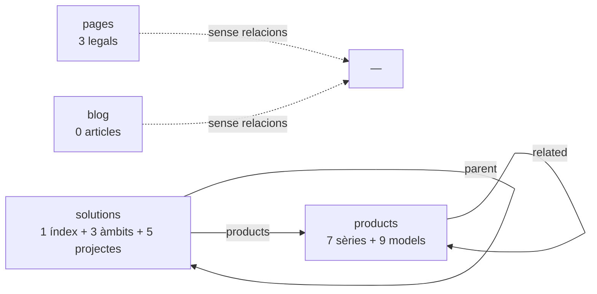
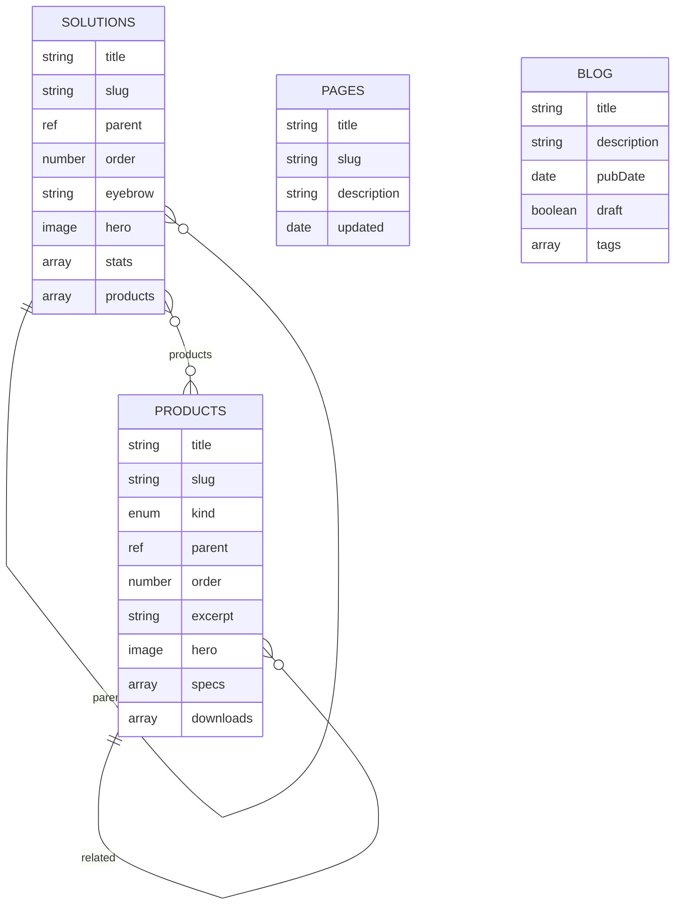

# 03 — Model de contingut

El web no és un conjunt de pàgines escrites a mà: és un **catàleg de dades** que Astro converteix en URLs. Aquest document descriu les quatre col·leccions, els seus esquemes Zod, les relacions entre entrades i les convencions que fan que el model funcioni.

> [!IMPORTANT]
> La regla estructural del projecte és **`slug = id = URL`**. No és una convenció cosmètica: el loader `glob` d'Astro fa servir el camp `slug` del frontmatter com a `id` de l'entrada, i totes les referències (`parent`, `related`, `products`) apunten a aquest `id`. Canviar un slug canvia alhora la URL, l'id i totes les referències que l'apuntaven.

## 1. Per què Content Collections

Astro permet dues aproximacions per al contingut:

| Opció | Avantatges | Inconvenients | Ús actual |
|---|---|---|---|
| Pàgines `.astro` amb dades hardcoded | Màxim control, zero abstracció | Duplicació, sense validació, escala malament | Home, contacto, FAQs, garanties, vídeos |
| Content Collections + Zod | Validació en build, tipus, relacions, render Markdown | Corba d'aprenentatge, esquema a mantenir | Productes, solucions, legals, blog |

El projecte reserva les col·leccions per a tot allò que és **repetible i estructurat** (fitxes, projectes, legals, articles) i deixa com a pàgines `.astro` les peces úniques de composició (home, contacto, FAQs). És una decisió raonable: les col·leccions aporten valor quan hi ha moltes entrades o quan el contingut l'edita algú que no toca codi.

## 2. Mapa de col·leccions



| Col·lecció | Loader | Fitxers | Entrades | URL pública |
|---|---|---|---:|---|
| `products` | `glob` sobre `./src/content/products` | `**/*.{md,mdx}` | 16 | `/{slug}/` |
| `solutions` | `glob` sobre `./src/content/solutions` | `**/*.{md,mdx}` | 9 | `/{slug}/` |
| `pages` | `glob` sobre `./src/content/pages` | `**/*.{md,mdx}` | 3 | `/{slug}/` |
| `blog` | `glob` sobre `./src/content/blog` | `**/*.{md,mdx}` | 0 | Encara no routat |

Totes les col·leccions viuen a `src/content.config.ts` i es registren al final del fitxer:

```ts
export const collections = { products, solutions, pages, blog };
```

## 3. Esquema comú de SEO

Cada entrada pot sobreescriure les metadades amb un bloc `seo` opcional:

```ts
const seo = z.object({
  title: z.string().optional(),
  description: z.string().max(160).optional(),
  image: z.string().optional(),
  noindex: z.boolean().default(false),
});
```

| Camp | Tipus | Restricció | Efecte |
|---|---|---|---|
| `title` | string | opcional | Substitueix el `<title>`; `SEO.astro` hi afegeix `\| LifeTech` si no hi és |
| `description` | string | **màxim 160 caràcters** | Substitueix la descripció; si falta, s'usa `excerpt` o `description` |
| `image` | string | opcional | Ruta o URL per a `og:image`; si falta, s'usa `/images/og-default.jpg` |
| `noindex` | boolean | default `false` | Genera `noindex, follow` i **elimina el canonical** |

La validació de 160 caràcters és en build: una descripció massa llarga trenca `astro build`/`astro check`. És una bona xarxa de seguretat, però no substitueix la revisió editorial.

## 4. Col·lecció `products`

### 4.1 Esquema

```ts
const products = defineCollection({
  loader: glob({ base: './src/content/products', pattern: '**/*.{md,mdx}' }),
  schema: ({ image }) =>
    z.object({
      title: z.string(),
      /** Ruta completa sense barres: "ress/ress-300-200". Defineix la URL final. */
      slug: z.string(),
      kind: z.enum(['series', 'model']),
      parent: reference('products').optional(),
      order: z.number().default(0),
      excerpt: z.string(),
      hero: image(),
      gallery: z.array(z.object({ src: image(), alt: z.string() })).default([]),
      features: z
        .array(
          z.object({
            icon: z.string().default('lucide:check'),
            title: z.string(),
            text: z.string(),
          }),
        )
        .default([]),
      highlights: z.array(z.object({ value: z.string(), label: z.string() })).default([]),
      specs: z.array(z.object({ label: z.string(), value: z.string() })).default([]),
      downloads: z
        .array(
          z.object({
            label: z.string(),
            kind: z.enum(['datasheet', 'warranty', 'inverter-guide', 'manual']),
            href: z.string().optional(),
          }),
        )
        .default([]),
      related: z.array(reference('products')).default([]),
      seo: seo.optional(),
    }),
});
```

### 4.2 Camps

| Camp | Obligatori | Tipus | Notes |
|---|---|---|---|
| `title` | ✅ | string | Nom visible a la fitxa, menús i JSON-LD |
| `slug` | ✅ | string | Ruta completa sense barres. **És l'`id` de l'entrada** |
| `kind` | ✅ | `series` \| `model` | Discrimina jerarquia i etiqueta (“Serie”/“Modelo”) |
| `parent` | ❌ | reference a `products` | Només als models; apunta a l'`id` de la sèrie |
| `order` | ❌ | number, default `0` | Ordre dins de la sèrie o del llistat |
| `excerpt` | ✅ | string | Resum curt; s'usa a targetes, meta description per defecte i hero |
| `hero` | ✅ | image() | Imatge principal; validada i optimitzada per Astro |
| `gallery` | ❌ | array `{src, alt}` | `alt` obligatori per element |
| `features` | ❌ | array `{icon, title, text}` | Icones Lucide via `astro-icon` |
| `highlights` | ❌ | array `{value, label}` | Banda de xifres clau |
| `specs` | ❌ | array `{label, value}` | Taula de característiques; tot és string |
| `downloads` | ❌ | array `{label, kind, href?}` | `kind` controla la icona; `href` pot faltar |
| `related` | ❌ | array reference a `products` | Productes relacionats |
| `seo` | ❌ | objecte `seo` | Overrides de metadades |

### 4.3 Jerarquia sèrie/model

No hi ha una col·lecció separada per a sèries i models: conviuen a `products` i es distingeixen per `kind`. La relació és:

```text
products
├─ kind: series   id: ress
│  ├─ kind: model id: ress/ress-75-50      parent: ress
│  ├─ kind: model id: ress/ress-150-100    parent: ress
│  ├─ kind: model id: ress/ress-225-150    parent: ress
│  └─ kind: model id: ress/ress-300-200    parent: ress
├─ kind: series   id: lt5000-series
│  ├─ kind: model id: lt5000-series/lt5000-fc-single-module
│  └─ kind: model id: lt5000-series/lt5000-fc-stacked
├─ kind: series   id: lt-hv
│  ├─ kind: model id: lt-hv/lt-hv-480-v-ebc-battery-system
│  └─ kind: model id: lt-hv/lt-hv-768-v-ebc-battery-system
├─ kind: series   id: lt-12v-24v-series
│  └─ kind: model id: lt-12v-24v-series/lfp-24100
├─ kind: series   id: lv-lite-series
├─ kind: series   id: hv-lite-series
└─ kind: series   id: lt5000r-series
```

Conseqüències:

- Una sèrie pot no tenir models (LV-LITE, HV-LITE, LT5000R). És vàlid.
- Un model **hauria** de tenir `parent`; l'esquema no ho pot exigir condicionalment amb una simple `z.object` (es podria amb `superRefine`, però no s'ha fet).
- El layout resol el pare amb `allProducts.find(item => item.id === entry.data.parent?.id)`. Si el `parent` no coincideix, **no falla el build**: simplement no es mostra l'engruna ni el vincle de sèrie. És un punt cec (vegeu [09](09-deute-tecnic-i-riscos.md)).

### 4.4 Per què el slug és el id

El loader `glob` accepta un `generateId`, i la implementació per defecte fa això:

```js
// node_modules/astro/dist/content/loaders/glob.js
function generateIdDefault({ entry, base, data }) {
  if (data.slug) {
    return String(data.slug);
  }
  // ...si no hi ha slug, deriva l'id del path del fitxer
}
```

Per tant:

1. `slug: ress/ress-300-200` → `entry.id === 'ress/ress-300-200'`.
2. `parent: ress` → `{ collection: 'products', id: 'ress' }`, que coincideix amb l'id de `ress.md`.
3. `related: [ress/ress-75-50]` → referencia l'id complet, no el nom de fitxer.
4. `getStaticPaths` fa servir `entry.data.slug` per construir la ruta; com que és el mateix valor, URL i id no es poden desincronitzar mentre es mantingui la convenció.

> [!WARNING]
> Si en el futur es canvia un `slug`, cal actualitzar **totes** les referències que l'apuntin i, si la URL antiga ja estava indexada, afegir un redirect 301 a `deploy/nginx/redirects.conf`. No n'hi ha prou de renombrar el fitxer.

### 4.5 Ordre

`order` és un number amb default `0`. Tots els llistats fan el mateix patró:

```ts
const sortByOrder = (entries) => [...entries].sort((a, b) => a.data.order - b.data.order);
```

No hi ha desempat explícit: amb `order` iguals, l'ordre depèn de l'ordre d'entrada de `getCollection`. És acceptable per a un catàleg petit, però fràgil si dues persones editen alhora. Recomanació: fer els `order` únics per nivell (10, 20, 30…) i documentar-ho.

## 5. Col·lecció `solutions`

### 5.1 Esquema

```ts
const solutions = defineCollection({
  loader: glob({ base: './src/content/solutions', pattern: '**/*.{md,mdx}' }),
  schema: ({ image }) =>
    z.object({
      title: z.string(),
      /** Ruta completa sense barres: "soluciones/soluciones-residenciales". */
      slug: z.string(),
      parent: reference('solutions').optional(),
      order: z.number().default(0),
      eyebrow: z.string().optional(),
      excerpt: z.string(),
      hero: image(),
      icon: z.string().default('lucide:home'),
      stats: z.array(z.object({ value: z.string(), label: z.string() })).default([]),
      products: z.array(reference('products')).default([]),
      seo: seo.optional(),
    }),
});
```

### 5.2 Dues coses en una sola col·lecció

`solutions` conté **tres nivells lògics**:

| Nivell | Exemple | `parent` | URL |
|---|---|---|---|
| Índex | `soluciones` | — | `/soluciones/` |
| Àmbit | `soluciones/soluciones-residenciales` | `soluciones` | `/soluciones/soluciones-residenciales/` |
| Projecte | `soluciones/soluciones-industriales-y-comerciales/estacion-de-carga-solar-bess` | `soluciones/soluciones-industriales-y-comerciales` | `/soluciones/soluciones-industriales-y-comerciales/estacion-de-carga-solar-bess/` |

No hi ha un camp `type` que distingeixi àmbit de projecte. El layout ho infereix amb una heurística:

```ts
const childKind = data.slug === 'soluciones' ? 'solucion' : 'proyecto';
```

És a dir: **els fills de l'índex són àmbits; els fills de qualsevol altra solució són projectes**. Funciona per a l'arbre actual de dos nivells, però bloqueja jerarquies més profundes o un projecte penjat directament de `/soluciones/`. És un dels principals punts a refactoritzar a [08](08-escalabilitat-i-evolucio-del-model.md).

### 5.3 Relació amb productes

El camp `products` és un array de referències a `products`. El layout les resol i les pinta a “Tecnología utilizada”:

```ts
const relatedProducts = entry.data.products
  .map((reference) => products.find((item) => item.id === reference.id))
  .filter((item): item is CollectionEntry<'products'> => Boolean(item));
```

Igual que amb `parent`, una referència incorrecta es descarta en silenci.

## 6. Col·lecció `pages`

```ts
const pages = defineCollection({
  loader: glob({ base: './src/content/pages', pattern: '**/*.{md,mdx}' }),
  schema: z.object({
    title: z.string(),
    slug: z.string(),
    description: z.string(),
    updated: z.coerce.date(),
    seo: seo.optional(),
  }),
});
```

| Camp | Tipus | Notes |
|---|---|---|
| `title` | string | Títol de la pàgina |
| `slug` | string | Ruta completa; `aviso-legal` → `/aviso-legal/` |
| `description` | string | Descripció base (no limitada a 160; `clampDescription` la retalla) |
| `updated` | data | `z.coerce.date()` accepta `2025-01-31` i el converteix a `Date` |
| `seo` | opcional | Overrides |

Aquesta col·lecció és per a text llarg legal, no per a pàgines de composició. El layout `LegalLayout` pinta la data d'actualització i un aside amb informació legal.

## 7. Col·lecció `blog`

```ts
const blog = defineCollection({
  loader: glob({ base: './src/content/blog', pattern: '**/*.{md,mdx}' }),
  schema: ({ image }) =>
    z.object({
      title: z.string(),
      description: z.string(),
      pubDate: z.coerce.date(),
      updatedDate: z.coerce.date().optional(),
      hero: image().optional(),
      author: z.string().default('LifeTech'),
      tags: z.array(z.string()).default([]),
      draft: z.boolean().default(false),
      seo: seo.optional(),
    }),
});
```

L'esquema està preparat, però:

- No hi ha cap article (`src/content/blog/.gitkeep`).
- No hi ha ruta dinàmica d'article ni RSS.
- L'índex `/blog/` és un placeholder amb `noindex`.
- `@astrojs/rss` està instal·lat però no s'importa enlloc.

És un scaffold, no una funcionalitat acabada. Vegeu la recepta 5 de [07](07-guia-afegir-productes-i-projectes.md).

## 8. Model híbrid: frontmatter + Markdown

Cada fitxa combina dues capes:

| Capa | On va | Per a què |
|---|---|---|
| **Estructurada** | Frontmatter | Dades que el layout necessita per composar: hero, specs, features, downloads, relacions |
| **Narrativa** | Cos Markdown | Text llarg amb H2/H3, llistes, negretes i enllaços |

Aquesta separació és deliberada:

- El layout pot renderitzar seccions riques (taula d'specs, graella de features) sense parsejar Markdown.
- El contingut narratiu es pot editar sense tocar el disseny.
- Les dades estructurades es validen; el Markdown no.

El cost és que hi ha informació que viu en dos llocs (p. ex. una especificació destacada a `highlights` i la mateixa a `specs`). Cal mantenir la coherència editorial.

### Ordre de render a `ProductLayout`

1. Hero + breadcrumbs + CTAs + `highlights`.
2. `features` (si n'hi ha).
3. Cos Markdown + taula `specs`.
4. `gallery` (si n'hi ha).
5. `downloads` (si n'hi ha).
6. Fills (models de la sèrie).
7. `related`.
8. CTA final.

Les seccions 2, 4, 5, 6 i 7 són condicionals: un array buit no genera secció. Això permet que una sèrie sense models o un model sense galeria sigueixin sent una pàgina vàlida.

## 9. Imatges i fitxers

### 9.1 Imatges de contingut

Els camps `hero` i `gallery[].src` fan servir el helper `image()` de l'esquema. Això:

- Valida que el fitxer existeixi en build.
- Retorna `ImageMetadata` (amplada, alçada, format, `src`).
- Permet `astro:assets` generar múltiples amplades i formats.

Convenció de rutes: imports relatius des del Markdown.

```yaml
hero: ../../assets/images/products/ress-300-200-hero.webp
gallery:
  - src: ../../assets/images/products/ress-300-200-2.webp
    alt: RESS 300-200, vista general
```

No hi ha imatges remotes a les col·leccions. Els logos de marca i els PDFs viuen a `public/` perquè no necessiten transformació.

### 9.2 PDFs i descàrregues

Els PDFs són a `public/descargas/` i es referencien amb rutes absolutes:

```yaml
downloads:
  - label: Ficha técnica RESS
    kind: datasheet
    href: /descargas/ficha-tecnica-ress.pdf
```

`kind` és un enum tancat (`datasheet`, `warranty`, `inverter-guide`, `manual`) que el layout tradueix a una icona. `href` és opcional: una descàrrega sense PDF es pot declarar igualment, però el layout només pinta les que tenen `href`.

> [!NOTE]
> La llista de PDFs també està duplicada a `src/pages/descarga-productos.astro`, que agrupa els fitxers per tipus. Afegir un PDF a una fitxa **no** l'afegeix automàticament a la pàgina de descàrregues. Vegeu [09](09-deute-tecnic-i-riscos.md).

## 10. Convencions de noms i fitxers

| Element | Convenció | Exemple |
|---|---|---|
| Fitxer de contingut | Minúscules, guions, sense accents | `ress-300-200.md` |
| `slug` de sèrie | Només el nom | `ress` |
| `slug` de model | `serie/model` | `ress/ress-300-200` |
| `slug` de solució | `soluciones/<nom>` | `soluciones/soluciones-residenciales` |
| `slug` de projecte | `soluciones/<àmbit>/<projecte>` | `soluciones/soluciones-industriales-y-comerciales/estacion-de-carga-solar-bess` |
| `slug` legal | Nom pla | `aviso-legal` |
| Imatge hero | `<slug>-hero.webp` | `ress-300-200-hero.webp` |
| Galeria | `<slug>-2.webp`, `<slug>-3.webp` | `ress-300-200-2.webp` |
| PDF | `<tipus>-<producte>.pdf` | `ficha-tecnica-ress.pdf` |

L'`id` no depèn del nom del fitxer perquè `slug` el sobreescriu, però mantenir el nom alineat evita confusions. El cas dels projectes és especial: el fitxer és `estacion-de-carga-solar-bess.md` i el `slug` inclou el path complet. És correcte, però visualment pot enganyar.

## 11. Plantilles de frontmatter

### 11.1 Sèrie

```yaml
---
title: RESS
slug: ress
kind: series
order: 10
excerpt: Sistema inteligente de suministro de energía que integra batería de litio y convertidor DC/AC en un contenedor exterior IP54.
hero: ../../assets/images/products/ress-75-50-hero.webp
gallery:
  - src: ../../assets/images/products/ress-75-50-2.webp
    alt: Vista frontal del sistema RESS de LifeTech
features:
  - icon: lucide:plug-zap
    title: Plug & Play
    text: Sistema todo en uno que se entrega configurado.
highlights:
  - value: 75 kWh – 1,84 MWh
    label: Rango de capacidad
specs:
  - label: Tensión nominal de batería
    value: 768 VDC
downloads:
  - label: Ficha técnica RESS
    kind: datasheet
    href: /descargas/ficha-tecnica-ress.pdf
related:
  - ress/ress-75-50
seo:
  description: Sistemas RESS de LifeTech para almacenamiento industrial y respaldo.
---
```

### 11.2 Model

```yaml
---
title: RESS 300-200
slug: ress/ress-300-200
kind: model
parent: ress
order: 4
excerpt: La configuración de mayor capacidad de la familia RESS.
hero: ../../assets/images/products/ress-300-200-hero.webp
gallery:
  - src: ../../assets/images/products/ress-300-200-2.webp
    alt: RESS 300-200, vista general
highlights:
  - value: 300 kWh
    label: Capacidad
specs:
  - label: Capacidad
    value: 300 kWh
related:
  - ress/ress-75-50
  - ress/ress-150-100
seo:
  description: RESS 300-200 de LifeTech, 300 kWh y 200 kW para almacenamiento industrial.
---
```

### 11.3 Projecte

```yaml
---
title: Estación de carga solar BESS
slug: soluciones/soluciones-industriales-y-comerciales/estacion-de-carga-solar-bess
parent: soluciones/soluciones-industriales-y-comerciales
order: 2
eyebrow: Proyecto industrial
excerpt: Instalación FV, almacenamiento, carga rápida de vehículos eléctricos y monitorización de red.
hero: ../../assets/images/solutions/estacion-carga-hero.webp
icon: lucide:ev-charger
stats:
  - value: 26,68 kWp
    label: Cubierta solar
products:
  - ress
  - lt-hv
seo:
  description: Estación de carga solar BESS con 26,68 kWp, 250 kW de convertidor y 550 kWh de batería.
---
```

### 11.4 Legal

```yaml
---
title: Aviso legal
slug: aviso-legal
description: Información legal de LifeTech Energy Solucions.
updated: 2025-01-31
seo:
  description: Aviso legal de LifeTech Energy Solucions.
---
```

## 12. Regles d'integritat (i els seus buits)

| Regla | Com es garanteix avui | Risc si falla |
|---|---|---|
| Tots els camps obligatoris existeixen | Zod en build | Build trencat (bo) |
| `description` ≤ 160 | Zod | Build trencat (bo) |
| La imatge hero existeix | `image()` | Build trencat (bo) |
| `slug` únic | `id` de col·lecció | Build trencat per id duplicat (bo) |
| `parent` apunta a una entrada real | **No verificat** | Sense breadcrumb/vincle, silenciós |
| `related` apunta a entrades reals | **No verificat** | Targeta desapareguda, silenciós |
| `products` d'una solució existeixen | **No verificat** | Targeta desapareguda, silenciós |
| `order` únic per nivell | Convenció | Ordre inestable |
| PDF referenciat existeix | `npm run qa` valida fitxers enllaçats a l'HTML | Detectat després del build |
| Imatge OG accessible | No verificat | OG trencada |

La recomanació és afegir un script de validació de referències i orfes (vegeu [08](08-escalabilitat-i-evolucio-del-model.md), fase 2).

## 13. Diagrama de relacions



## 14. Quan NO fer servir una col·lecció

No tot ha de ser col·lecció. Les pàgines següents són `.astro` perquè són **composicions úniques** i no entrades repetibles:

- Home (`src/pages/index.astro`)
- Contacto, FAQs, garanties, vídeos, suport, descàrregues
- Índex de productes i de solucions

Convertir-les en col·lecció afegiria esquema i abstracció sense reduir duplicació real. La frontera raonable és: **si el contingut es repeteix amb la mateixa forma i algú el voldrà editar sense tocar codi, col·lecció; si és una pàgina única de composició, `.astro`**.
