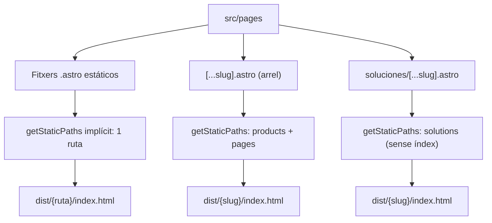
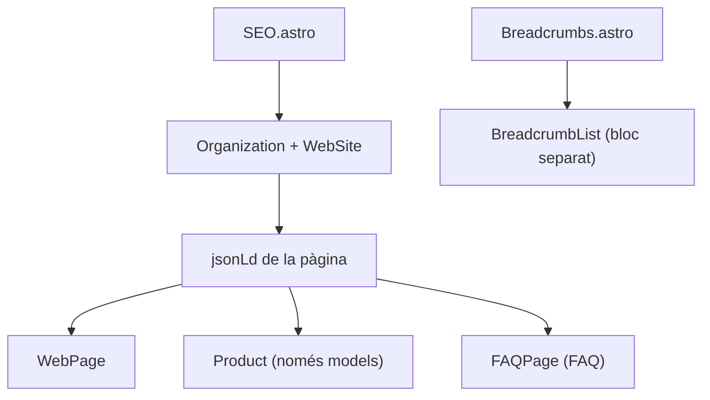
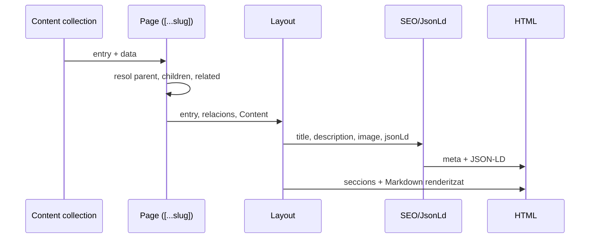

# 04 — Rutes, layouts i components

Aquest document explica com el model de contingut es converteix en URLs, quines plantilles componen cada pàgina i com es reparteix la responsabilitat entre pàgines, layouts, components i llibreries.

## 1. Model de routing

Astro genera **una pàgina estàtica per cada ruta** en build. No hi ha servidor d'aplicació ni render per request: nginx només serveix fitxers. Les rutes surten de tres fonts:

| Font | Fitxer | Rutes |
|---|---|---|
| Rutes estàtiques | `src/pages/**/*.astro` | Home, corporatives, legals, índexs, 404 |
| Rutes dinàmiques d'arrel | `src/pages/[...slug].astro` | Productes i pàgines legals |
| Rutes dinàmiques de solucions | `src/pages/soluciones/[...slug].astro` | Àmbits i projectes |



### 1.1 Per què `build.format: 'directory'`

`astro.config.mjs` fixa:

```js
trailingSlash: 'always',
build: {
  format: 'directory',
},
```

Conseqüències:

- `/nosotros/` → `dist/nosotros/index.html`.
- `/nosotros` (sense barra) → nginx fa 301 a `/nosotros/` perquè el directori existeix.
- Totes les URLs publiquen i reben barra final, igual que el WordPress original.
- Els enllaços interns del codi ja inclouen la barra (`href="/contacto/"`).

Aquesta decisió protegeix l'SEO de la migració: evita canònics duplicats i manté les URLs antigues amb la mateixa forma. Si es canviés a `format: 'file'`, caldria revisar tots els enllaços i els redirects.

### 1.2 Rutes generades

L'arbre actual genera **41 pàgines HTML** (40 al `dist/` auditat + `/productos/`, afegit al darrer commit i pendent de build):

| Grup | Rutes |
|---|---|
| Home | `/` |
| Corporatiu | `/nosotros/`, `/contacto/`, `/faqs/`, `/soporte-en-linea/`, `/videos/`, `/descarga-productos/`, `/garantia-del-inversor/`, `/garantia-de-la-bateria/` |
| Productes | `/productos/` (índex) |
| Productes — RESS | `/ress/`, `/ress/ress-75-50/`, `/ress/ress-150-100/`, `/ress/ress-225-150/`, `/ress/ress-300-200/` |
| Productes — LV/HV | `/lv-lite-series/`, `/hv-lite-series/` |
| Productes — LT5000 | `/lt5000-series/`, `/lt5000-series/lt5000-fc-single-module/`, `/lt5000-series/lt5000-fc-stacked/` |
| Productes — LT5000R | `/lt5000r-series/` |
| Productes — LT-12V/24V | `/lt-12v-24v-series/`, `/lt-12v-24v-series/lfp-24100/` |
| Productes — LT-HV | `/lt-hv/`, `/lt-hv/lt-hv-480-v-ebc-battery-system/`, `/lt-hv/lt-hv-768-v-ebc-battery-system/` |
| Solucions | `/soluciones/`, `/soluciones/soluciones-residenciales/`, `/soluciones/soluciones-industriales-y-comerciales/`, `/soluciones/soluciones-plantas-fv/` |
| Projectes | 5 sota `/soluciones/soluciones-industriales-y-comerciales/<projecte>/` |
| Legal | `/aviso-legal/`, `/politica-de-privacidad/`, `/politica-de-cookies/` |
| Sistema | `/gracias/` (`noindex`), `/blog/` (`noindex`), `404.html`, `robots.txt`, `sitemap-index.xml`, `sitemap-0.xml` |

## 2. La ruta d'arrel `[...slug].astro`

### 2.1 Responsabilitat

Genera **productes** i **pàgines legals** des del mateix catch-all. No genera solucions perquè tenen el seu propi fitxer.

```ts
export async function getStaticPaths() {
  const [products, pages] = await Promise.all([getCollection('products'), getCollection('pages')]);

  return [
    ...products.map((entry) => ({
      params: { slug: entry.data.slug },
      props: { type: 'product' as const, entry },
    })),
    ...pages.map((entry) => ({
      params: { slug: entry.data.slug },
      props: { type: 'legal' as const, entry },
    })),
  ];
}
```

`params.slug` és el `slug` complet. Com que és un rest parameter (`[...slug]`), pot contenir barres: `ress/ress-300-200` genera `/ress/ress-300-200/`.

### 2.2 Discriminated union

La pàgina fa servir un `type` literal per saber quin layout muntar:

```ts
interface Props {
  type: 'product' | 'legal';
  entry: CollectionEntry<'products'> | CollectionEntry<'pages'>;
}
```

Després resol les relacions **abans** de passar-les al layout:

```ts
const parent = entry.data.parent
  ? allProducts.find((item) => item.id === entry.data.parent?.id)
  : undefined;

const children = sortByOrder(allProducts.filter((item) => item.data.parent?.id === entry.id));

const related = entry.data.related
  .map((reference) => allProducts.find((item) => item.id === reference.id))
  .filter((item): item is CollectionEntry<'products'> => Boolean(item));
```

Això manté els layouts “tontos”: reben dades ja resoltes i no consulten col·leccions. És una bona separació, però també és on les referències incorrectes s'empassen en silenci (`.filter(Boolean)`).

### 2.3 Per què no hi ha una col·lecció per a legals i una altra per a productes

Perquè comparteixen el mateix espai d'URLs (`/{slug}/`) i el mateix catch-all. Separar-les en dos fitxers `[...slug].astro` no és possible al mateix nivell; caldria prefixar les rutes o crear un sol fitxer que uneixi col·leccions, que és exactament el que fa aquest.

El risc és que un `slug` de producte i un de legal coincideixin. Avui no passa, però no hi ha una validació explícita. Vegeu [09](09-deute-tecnic-i-riscos.md).

## 3. La ruta de solucions `soluciones/[...slug].astro`

### 3.1 Responsabilitat

Genera tots els àmbits i projectes, **excepte l'índex**, que té el seu propi `soluciones/index.astro`.

```ts
export async function getStaticPaths() {
  const solutions = await getCollection('solutions');

  return solutions
    .filter((entry) => entry.data.slug !== 'soluciones')
    .map((entry) => ({
      params: { slug: entry.data.slug.replace(/^soluciones\//, '') },
      props: { entry },
    }));
}
```

La clau és el `replace`: el `slug` de contingut inclou el prefix `soluciones/`, però la ruta ja el proporciona la carpeta `src/pages/soluciones/`. Sense aquest `replace`, la URL seria `/soluciones/soluciones/...`.

### 3.2 Índex de solucions

`src/pages/soluciones/index.astro` carrega l'entrada `slug === 'soluciones'` i en renderitza els fills:

```ts
const entry = solutions.find((item) => item.data.slug === 'soluciones');

if (!entry) {
  throw new Error('Falta la entrada "soluciones" a la col·lecció de solucions.');
}
```

Aquest `throw` és una validació manual: si algú esborra o renombra l'índex, el build falla amb un missatge clar. És l'únic lloc del projecte on es fa aquest tipus de comprovació.

## 4. Precedència i col·lisions

Astro prioritza les rutes estàtiques sobre les dinàmiques. En aquest projecte:

| URL | Guanyador | Perdedor |
|---|---|---|
| `/productos/` | `src/pages/productos/index.astro` | `src/pages/[...slug].astro` |
| `/soluciones/` | `src/pages/soluciones/index.astro` | `src/pages/soluciones/[...slug].astro` |
| `/blog/` | `src/pages/blog/index.astro` | `src/pages/[...slug].astro` |
| `/ress/` | `src/pages/[...slug].astro` (producte) | — |
| `/soluciones/<àmbit>/` | `src/pages/soluciones/[...slug].astro` | `src/pages/[...slug].astro` (no hi arriba) |

### Riscos de col·lisió

1. **Slug duplicat entre `products` i `pages`** → dues entrades amb el mateix `params.slug` a `getStaticPaths`. Astro pot generar errors o sobreescriure; cal evitar-ho.
2. **Producte amb slug `productos/...`, `soluciones/...` o `blog/...`** → pot quedar ombrejat per una ruta estàtica o pel catch-all de solucions.
3. **Projecte amb el mateix slug que un àmbit** → `getStaticPaths` de solucions genera dues rutes iguals.
4. **Renombrar un slug** sense redirect → 404 net, sense avís.

No hi ha un test que ho detecti. La solució proposada és un script de validació d'IDs i rutes úniques (vegeu [08](08-escalabilitat-i-evolucio-del-model.md)).

## 5. Contractes dels layouts

### 5.1 `BaseLayout.astro`

És el shell comú de totes les pàgines.

| Prop | Tipus | Default | Funció |
|---|---|---|---|
| `title` | string? | — | Títol SEO |
| `description` | string? | — | Meta description |
| `image` | string? | — | OG image |
| `noindex` | boolean | `false` | Robots i canonical |
| `type` | `website` \| `article` | `website` | OG type |
| `jsonLd` | `JsonLdObject[]` | `[]` | Dades estructurades addicionals |
| `bodyClass` | string | `min-h-screen bg-white` | Classes del body |
| `headerOverlay` | boolean | `false` | Navbar transparent sobre hero |

Fa:

1. Importa `global.css`.
2. Carrega les fonts amb `<Font preload />`.
3. Munta `SEO`.
4. Pinta skip link, `Header`, `<main id="contenido">`, `Footer` i `Analytics`.

### 5.2 `ProductLayout.astro`

| Prop | Tipus | Funció |
|---|---|---|
| `entry` | `CollectionEntry<'products'>` | Dades de la fitxa |
| `parent` | entrada? | Sèrie a què pertany el model |
| `children` | entrades[] | Models de la sèrie |
| `related` | entrades[] | Productes relacionats |
| `Content` | `RenderResult['Content']` | Markdown renderitzat |

Seccions, en ordre:

1. Hero amb breadcrumbs, `h1`, `excerpt`, CTAs i vincle a la sèrie.
2. `highlights` (si n'hi ha).
3. `features` (si n'hi ha).
4. Cos Markdown + `specs` en taula.
5. `gallery` (si n'hi ha).
6. `downloads` (si n'hi ha).
7. `children` (si n'hi ha).
8. `related` (si n'hi ha).
9. CTA final.

Detalls tècnics:

- El títol SEO prioritza `data.seo.title ?? data.title`.
- La descripció prioritza `data.seo.description ?? data.excerpt`.
- El JSON-LD afegeix `Product` **només** si `kind === 'model'`. Les sèries no emeten `Product`.
- La imatge hero es carrega amb `loading="eager"` i `fetchpriority="high"` (LCP).
- Les imatges de galeria són `lazy`.
- La taula d'specs té `caption` només per a lectors de pantalla.
- Si no hi ha specs, es mostra un text que convida a consultar la fitxa PDF.

### 5.3 `SolutionLayout.astro`

| Prop | Tipus | Funció |
|---|---|---|
| `entry` | `CollectionEntry<'solutions'>` | Àmbit o projecte |
| `parent` | entrada? | Àmbit pare |
| `children` | entrades[] | Projectes o sub-àmbits |
| `products` | entrades[] | Productes relacionats |
| `Content` | `RenderResult['Content']` | Markdown |

Seccions:

1. Hero amb imatge de fons, gradient, breadcrumbs, `h1`, `excerpt`, CTA i enllaç al pare.
2. `stats` (si n'hi ha).
3. Cos Markdown + aside sticky amb contacte.
4. `children`: si l'entrada és `soluciones`, els fills es presenten com “àmbits”; si no, com “projectes”.
5. `products`: “Tecnología utilizada”.
6. Sense CTA final propi (el CTA viu a l'aside).

La heurística `data.slug === 'soluciones'` per decidir si els fills són àmbits o projectes és el punt més fràgil del layout. Vegeu [08](08-escalabilitat-i-evolucio-del-model.md).

### 5.4 `LegalLayout.astro`

| Prop | Tipus | Funció |
|---|---|---|
| `entry` | `CollectionEntry<'pages'>` | Pàgina legal |
| `Content` | `RenderResult['Content']` | Markdown |

Pinta data d'actualització amb `Intl.DateTimeFormat('es-ES')`, breadcrumb, contingut en `prose` i un aside amb informació legal. El `datetime` del `<time>` fa servir l'ISO de la data.

### 5.5 `PageHero.astro`

No és un layout complet, sinó un hero reutilitzable per a pàgines `.astro`:

| Prop | Tipus | Notes |
|---|---|---|
| `title` | string | `h1` |
| `description` | string? | Paràgraf |
| `eyebrow` | string? | Etiqueta superior |
| `crumbs` | `Crumb[]` | Breadcrumbs |
| `align` | `left` \| `center` | — |
| `image` | `ImageMetadata?` | Si hi ha imatge, hero fosc |
| `imageAlt` | string? | `''` per decorativa |
| `offsetHeader` | boolean | Puja el hero sota la navbar |

## 6. Inventari de components

### 6.1 UI

| Component | Props principals | Notes |
|---|---|---|
| `Container` | `as`, `size`, `class` | `narrow` 3xl, `default` 7xl, `wide` 90rem |
| `Section` | `id`, `tone`, `padding`, `container`, `size`, `class` | Tones `white`, `surface`, `brand`, `brand-dark` |
| `SectionHeading` | `eyebrow`, `title`, `description`, `align`, `as`, `tone` | `as` permet `h1`/`h2`/`h3` |
| `Button` | `href`, `variant`, `size`, `icon`, `iconPosition`, `type`, `external`, `disabled` | Si `href`, renderitza `<a>`; si no, `<button>` |
| `Card` | `href`, `padded`, `hover`, `class` | Targeta simple |
| `Icon` | `name`, `class`, `size`, `label` | `aria-hidden` si no hi ha `label` |
| `Breadcrumbs` | `items`, `tone`, `withSchema` | Emet `BreadcrumbList` per defecte |

### 6.2 Layout

| Component | Funció |
|---|---|
| `Header` | Navbar sticky, mega-menú, menú mòbil, estat de scroll |
| `Footer` | NAP, columnes de navegació, legals |
| `PageHero` | Hero de pàgines corporatives |
| `Breadcrumbs` | Engrunes + JSON-LD |

### 6.3 SEO

| Component | Funció |
|---|---|
| `SEO` | Títol, descripció, canonical, robots, OG, Twitter, JSON-LD base |
| `JsonLd` | Serialitza un objecte o array a `<script type="application/ld+json">` |

### 6.4 Forms i analytics

| Component | Funció |
|---|---|
| `ContactForm` | Formulari Web3Forms amb honeypot i millora progressiva amb JS |
| `Analytics` | Script d'Umami, només en producció |

### 6.5 Llibreries

| Fitxer | Funció |
|---|---|
| `src/lib/urls.ts` | `absoluteUrl`, `canonicalUrl`, `formatTitle`, `clampDescription`, `normalizePath`, `isActive` |
| `src/lib/schema.ts` | Constructors de JSON-LD i tipus `Crumb`/`JsonLdObject` |
| `src/lib/cn.ts` | Concatenació de classes sense dependències |
| `src/data/site.ts` | NAP, SEO global, xarxes, legals |
| `src/data/navigation.ts` | Menú principal, footer, productes i projectes |

## 7. Composició del JSON-LD

Cada pàgina acaba amb **un o més blocs JSON-LD**:



- `SEO.astro` sempre injecta `Organization` i `WebSite`.
- La pàgina afegeix `WebPage` i, si escau, `Product` o `FAQPage`.
- `Breadcrumbs` afegeix un bloc independent de `BreadcrumbList` tret que es passi `withSchema={false}`.
- `JsonLd` serialitza l'array sencer en un sol `<script>` per al bloc de `SEO`, i un altre per a les engrunes.

No hi ha un graf unificat amb `@graph`; hi ha diversos blocs. Funciona, però un validador estricte pot preferir un sol graf. Vegeu [05](05-seo-rendiment-i-accessibilitat.md).

## 8. JavaScript de client

No hi ha illes ni hidratació. Tot el JS és **vanilla TypeScript dins de `<script>` d'Astro**, que Astro empaqueta i carrega com a mòdul.

| Script | Línies aprox. | Què fa |
|---|---:|---|
| `Header.astro` | ~100 | Obre/ tanca mega-menú, hover amb temporitzador, clic fora, Escape, scroll, menú mòbil, resize, bloqueig de scroll |
| `ContactForm.astro` | ~50 | Valida, envia per `fetch`, mostra estat, redirigeix a `/gracias/` |
| `Analytics.astro` | 1 | Insereix Umami en producció |

### 8.1 Header

Patró:

- `data-dropdown-trigger`, `data-dropdown-panel`, `data-dropdown-root`.
- `aria-expanded` i `aria-controls` sincronitzats.
- `pointerenter`/`pointerleave` amb `setTimeout` de 180 ms per evitar parpelleig.
- `click` fora del header tanca.
- `Escape` tanca i retorna el focus al trigger.
- `scrollY > 16` activa `data-scrolled="true"`, que canvia fons i ombra.
- Mòbil: `hidden`, `aria-expanded`, `overflow-hidden` al body, canvi d'icona, tancament en clicar un enllaç, `Escape` i `resize >= 1024`.

Punts febles:

- El menú mòbil **no atrapa el focus** (no és un diàleg modal).
- Els enllaços de la versió mòbil estan hardcoded (Nosotros, Contacto, FAQs, Suport, Descàrregues) en lloc de derivar-se de `mainNav`. Un canvi de navegació no es propaga sol.
- El mega-menú no és navegable amb fletxes; només Tab.

### 8.2 ContactForm

- `action` i `method="POST"` reals: sense JS, el navegador envia a Web3Forms i el camp ocult `redirect` porta a `/gracias/`.
- Amb JS: `preventDefault`, `reportValidity`, `fetch` amb `FormData`, estat “Enviando…”, redirecció si `response.ok`, missatge d'error si falla.
- Honeypot `botcheck` ocult.
- `PUBLIC_FORM_ACCESS_KEY` s'inlinea en build; si falta, en dev es mostra un avís.
- No hi ha validació de servidor pròpia: la validació és HTML + Web3Forms.
- El formulari no associa els missatges d'error a cada camp (`aria-invalid`, `aria-describedby`), només un estat global.

### 8.3 Analytics

```astro
{enabled && (
  <script
    is:inline
    defer
    src={src}
    data-website-id={websiteId}
    data-domains="life-tech.es,www.life-tech.es"
    data-do-not-track="true"
    data-exclude-search="true"
  />
)}
```

`is:inline` és necessari per conservar `defer` i els atributs `data-*`. Sense `PUBLIC_ANALYTICS_ID` o en dev, no s'injecta res.

## 9. Flux de props



La regla implícita és: **les pàgines resolen dades; els layouts només pinten**. Es compleix a `[...slug].astro` i `soluciones/[...slug].astro`, però no a `productos/index.astro`, que fa les consultes i pinta directament. És acceptable perquè és una pàgina índex, no una fitxa.

## 10. Com afegir una nova plantilla

Si en el futur cal un tipus de pàgina nou (p. ex. casos d'èxit amb una estructura pròpia):

1. Decideix si és una entrada de col·lecció o una pàgina única.
2. Si és col·lecció: afegeix l'esquema a `content.config.ts` i les referències necessàries.
3. Crea el layout a `src/layouts/` amb props explícites i sense consultes a col·leccions.
4. Crea la ruta a `src/pages/` o afegeix-la al catch-all existent.
5. Resol les relacions a la pàgina, no al layout.
6. Afegeix el JSON-LD adequat a `src/lib/schema.ts`.
7. Actualitza navegació, sitemap (si cal filtrar), QA i aquests documents.

La prova de foc: el layout hauria de poder renderitzar-se amb dades mock sense importar `astro:content`.
