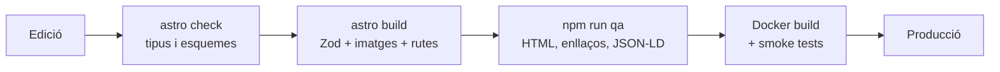

# 06 — Qualitat, operacions i desplegament

## 1. Model de qualitat

El projecte té quatre moments de validació:



| Moment | Eina | Què atura |
|---|---|---|
| Local | `npm run check` | Errors de TypeScript, props, esquemes |
| Build | `astro build` | Camps absents, descripcions >160, imatges inexistents, ids duplicats |
| Post-build | `npm run qa` | Títol curt, h1 incorrecte, canonical absent, JSON-LD invàlid, imatges sense alt, enllaços trencats |
| Desplegament | Docker + smoke tests | Contenidor no saludable, rutes crítiques |

No hi ha tests unitaris, E2E ni visual regression. Per a un lloc estàtic d'aquesta mida és assumible, però el QA actual té punts cecs rellevants.

## 2. Comandes

| Comanda | Què valida | Quan |
|---|---|---|
| `npm run check` | TypeScript + diagnòstics Astro | Abans de cada commit |
| `npm run build` | Generació completa | Abans de cada PR/desplegament |
| `npm run qa` | HTML de `dist/` | Després del build |
| `npm run format:check` | Format Prettier | CI |
| `npm run format` | Escriu format | Local |
| `npm run og` | Regenera OG | Quan canvia la marca |
| `npm run preview` | Serveix `dist/` | Revisió manual |

## 3. `scripts/qa.mjs` en detall

### 3.1 Què fa

1. Recorre tots els `.html` de `dist/`.
2. Per a cada pàgina comprova:
   - `<title>` present i ≥ 10 caràcters.
   - Exactament un `<h1>`.
   - Canonical present si la pàgina és indexable.
   - Que l'HTML no contingui la cadena `undefined`.
   - Cap `href=""` ni `src=""`.
   - Tots els `` tenen `alt`.
   - Tots els blocs JSON-LD parsegen.
3. Recull els enllaços interns (`href="/..."`) i comprova que existeixi el fitxer o `index.html`.
4. Valida fitxers obligatoris: `robots.txt`, `sitemap-index.xml`, `favicon.svg`, `images/og-default.jpg`.
5. Retorna codi de sortida 1 si hi ha problemes, enllaços trencats o fitxers absents.

### 3.2 Punts cecs

| No comprova | Risc | Com cobrir-ho |
|---|---|---|
| Descripció present o ≤160 | Metadades pobres | Afegir regex de `meta name="description"` |
| Canonical correcte (host, path, barra) | Canonical erroni | Comparar amb la ruta esperada |
| `og:image`, `og:title`, `twitter:*` | Compartits trencats | Validar presència i URL absoluta |
| Semàntica del JSON-LD | Rich results invàlids | Schema.org validator / `structured-data-testing-tool` |
| Enllaços relatius (`href="foo/"`) | 404 no detectat | Ampliar el crawler |
| `src` d'imatges i scripts | Imatge trencada | Validar `src` |
| Enllaços externs | 404 extern | Crawler opcional (pot ser sorollós) |
| Cobertura del sitemap | Pàgina indexable fora del sitemap | Comparar rutes HTML vs sitemap |
| Referències de contingut | `parent`/`related` orfes | Script sobre col·leccions |
| Ordre de headings | H2 abans de H1, salts | Validador HTML/axe |
| Accessibilitat | Contrast, focus, ARIA | axe-core/Lighthouse |
| Rendiment | LCP, pes, CWV | Lighthouse CI |
| HTML vàlid | Nesting incorrecte | `html-validate` |
| `lang` | Idioma incorrecte | Comprovació simple |
| Duplicats d'ID | ARIA trencada | Validador |

> [!NOTE]
> La comprovació de `undefined` és útil però pot donar falsos positius si algun text legítim conté aquesta paraula. No ha passat, però convé tenir-ho present.

### 3.3 Millores prioritàries del QA

1. Validar `meta description` i canonical esperat.
2. Validar OG/Twitter i que `og:image` comenci per `https://`.
3. Detectar referències orfes a les col·leccions.
4. Comparar sitemap vs pàgines indexables.
5. Afegir Lighthouse CI amb pressupostos.

## 4. CI proposat

No hi ha `.github/workflows/` al repositori. Un pipeline mínim:

```yaml
name: ci

on:
  pull_request:
  push:
    branches: [main]

jobs:
  quality:
    runs-on: ubuntu-latest
    steps:
      - uses: actions/checkout@v4
      - uses: actions/setup-node@v4
        with:
          node-version: 24
          cache: npm
      - run: npm ci
      - run: npm run format:check
      - run: npm run check
      - run: npm run build
        env:
          PUBLIC_SITE_URL: https://life-tech.es
          PUBLIC_FORM_ENDPOINT: https://api.web3forms.com/submit
          PUBLIC_FORM_ACCESS_KEY: ${{ secrets.PUBLIC_FORM_ACCESS_KEY }}
          PUBLIC_ANALYTICS_SRC: https://cloud.umami.is/script.js
          PUBLIC_ANALYTICS_ID: ${{ secrets.PUBLIC_ANALYTICS_ID }}
      - run: npm run qa
      - uses: actions/upload-artifact@v4
        with:
          name: dist
          path: dist
```

Opcions:

- **Lighthouse CI** amb `@lhci/cli` i pressupostos de Performance/Accessibility/SEO.
- **Deploy preview** per branca: publicar `dist/` en un hosting estàtic o un contenidor efímer.
- **Docker build** al CI i push a GHCR, deixant Dokploy només el `docker pull`.
- **`npm audit`** setmanal, no bloquejant.

## 5. Desplegament

El runbook complet és a [`deploy/dokploy.md`](../deploy/dokploy.md). Resum operatiu:

### 5.1 Configuració Dokploy

| Camp | Valor |
|---|---|
| Source Type | Git (GitHub) |
| Repositori | `mutRec/web-lifetech` |
| Branch | `main` |
| Build Type | **Dockerfile** (no Static) |
| Dockerfile Path | `Dockerfile` |
| Port | `80` |
| Healthcheck | `/healthz` |
| Dominis | `life-tech.es`, `www.life-tech.es` |
| TLS | Let's Encrypt via Traefik |

### 5.2 Build args

`PUBLIC_SITE_URL`, `PUBLIC_FORM_ENDPOINT`, `PUBLIC_FORM_ACCESS_KEY`, `PUBLIC_ANALYTICS_SRC`, `PUBLIC_ANALYTICS_ID`.

Si es passen només com a variables de runtime, el build les ignora i el web surt sense formulari ni analítica. **Han de ser build args.**

### 5.3 Post-desplegament

Smoke tests:

| URL | Esperat |
|---|---|
| `/` | 200 |
| `/productos/` | 200 |
| `/ress/ress-300-200/` | 200 |
| `/soluciones/soluciones-industriales-y-comerciales/estacion-de-carga-solar-bess/` | 200 |
| `/contacto/` | 200 + formulari |
| `/nosotros` | 301 → `/nosotros/` |
| `/hello-world/` | 301 → `/blog/` |
| `/wp-login.php` | 410 |
| `/sitemap-index.xml` | 200 |
| `/robots.txt` | 200 + `Sitemap:` |
| `/healthz` | 200 `ok` |

```bash
curl -sI https://life-tech.es/nosotros | findstr /i "HTTP location"
```

## 6. Rollback i recuperació

| Escenari | Acció |
|---|---|
| El deploy trenca pàgines | Rollback a deployment anterior a Dokploy |
| Asset 404 després de purge | Mantenir `_astro/` antic o redeployar la versió que el referencia |
| Formulari no arriba | Revisar `PUBLIC_FORM_ACCESS_KEY`, endpoint i bústia de Web3Forms |
| TLS caducat | Revisar Traefik/Let's Encrypt a Dokploy |
| DNS incorrecte | Verificar A/CNAME i propagació |
| Contingut erroni | Revertir commit i redeployar |
| Build falla per Zod | Corregir l'entrada; el build no publica res |

No hi ha base de dades ni estat persistent. **El backup és Git + la imatge Docker/registre.** Els PDFs i imatges són al repositori.

## 7. Monitoratge

| Senyal | Eina | Freqüència |
|---|---|---|
| Disponibilitat | Uptime check a `/healthz` | 1–5 min |
| Tràfic i conversions | Umami | Diari/setmanal |
| Errors 404 | Logs nginx + Search Console | Setmanal |
| Indexació i Core Web Vitals | Search Console | Mensual |
| Entrega del formulari | Prova manual + bústia | Mensual |
| Caducitat TLS | Dokploy/Traefik | Automàtic |
| Vulnerabilitats | `npm audit` | Mensual |
| Mida de la imatge | `docker images` | Trimestral |

## 8. Postura de seguretat

### 8.1 Fortaleses

- Superfície mínima: no hi ha runtime d'aplicació ni base de dades.
- HTML estàtic: no hi ha injecció de servidor.
- Headers de seguretat complets.
- HSTS amb `includeSubDomains`.
- Superfície WordPress retornada com a 410.
- Formulari delegat a Web3Forms amb honeypot.
- Analítica sense cookies.
- Dependències poques i actualitzables.

### 8.2 Deute de seguretat

| Tema | Estat | Recomanació |
|---|---|---|
| CSP | `Report-Only` | Passar a enforcing després de revisar violacions |
| `'unsafe-inline'` a CSP | Necessari avui | Reduir amb hashes/nonces |
| Imatge nginx | Corre com a root (master) | `nginxinc/nginx-unprivileged` o usuari no root |
| `npm audit` | No automatitzat | Afegir al CI |
| SRI | No aplicable (tot local) |— |
| Rate limiting | No hi ha | No cal amb nginx estàtic; el formulari el filtra Web3Forms |
| Secrets | Cap secret real al repo | La clau Web3Forms és pública per disseny |
| Permissions-Policy | Completa | ✅ |

## 9. Playbook d'incidents

### 9.1 “La web no carrega”

1. Comprovar `https://life-tech.es/healthz`.
2. Si falla: estat del contenidor a Dokploy, logs, rollback.
3. Si `/healthz` va però les pàgines no: revisar `try_files`, `dist/` i permisos.
4. Si és DNS/TLS: revisar Traefik i els registres.

### 9.2 “Una pàgina nova dóna 404”

1. Confirmar que el fitxer és a `src/content/...` amb `slug` correcte.
2. `npm run build`; comprovar que la ruta apareix a `dist/`.
3. Si no apareix: `kind`/`parent`/col·lecció incorrectes.
4. Si apareix en local però no a producció: el deploy no ha inclòs el commit o la caché de HTML és incorrecta.

### 9.3 “El formulari no envia”

1. Revisar la consola del navegador (CSP, xarxa).
2. Confirmar `PUBLIC_FORM_ACCESS_KEY` al build arg.
3. Provar l'endpoint de Web3Forms directament.
4. Revisar la bústia i la carpeta de spam.
5. Comprovar que `form-action` de la CSP inclou Web3Forms (en Report-Only no bloqueja, però en enforcing sí).

### 9.4 “Search Console marca pàgines no indexables”

1. `/blog/` i `/gracias/` són `noindex` per disseny.
2. Comprovar que no s'han enllaçat des del menú.
3. Revisar el sitemap: no hi han de ser.
4. Si és una pàgina nova, revisar `seo.noindex` i el filtre del sitemap.

### 9.5 “El build falla”

| Error | Causa probable | Solució |
|---|---|---|
| `description` too long | `seo.description` > 160 | Retallar |
| Image not found | Ruta d'import incorrecta | Corregir ruta relativa |
| Duplicate id | Dos fitxers amb el mateix `slug` | Renombrar |
| Missing entry | `parent`/`related` inexistent | Corregir referència |
| Type error | Props d'un layout | `npm run check` |

## 10. Checklist de release

- [ ] `npm ci`
- [ ] `npm run format:check`
- [ ] `npm run check`
- [ ] `npm run build`
- [ ] `npm run qa`
- [ ] Revisió visual de `/`, `/productos/`, una fitxa, un projecte, `/contacto/`
- [ ] Smoke tests post-deploy
- [ ] Search Console: enviar sitemap si hi ha URLs noves
- [ ] Umami: confirmar visites
- [ ] Formulari: prova real d'enviament
- [ ] Actualitzar `README`/`doc` si ha canviat el model
